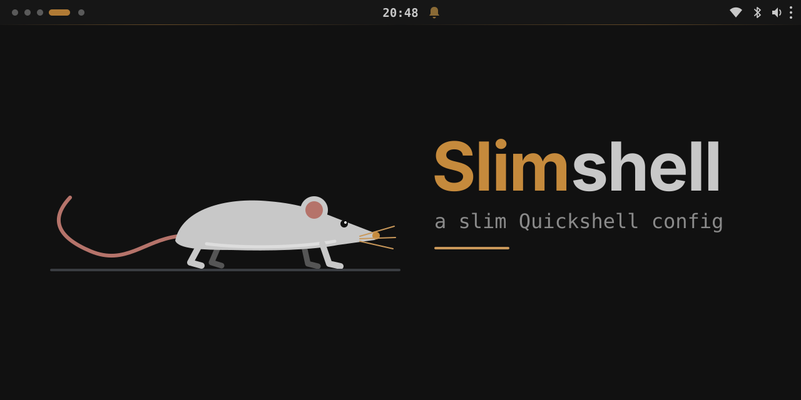

<p align="center">
  
</p>

<p align="center">
  A compact, keyboard-first desktop shell for <a href="https://github.com/YaLTeR/niri">Niri</a>, built with <a href="https://quickshell.org/">Quickshell</a>.
</p>

<p align="center">
  <a href="#features">Features</a> · <a href="#launcher">Launcher</a> · <a href="#dmenu-mode">Dmenu mode</a> · <a href="#getting-started">Getting started</a>
</p>

## Slimshell

Slimshell brings my bar, notifications, and some useful menus together—replacing a collection of separate tools and increasingly complicated Bash scripts.

It is built for my own desktop: compact, opinionated, and comfortable to use from the keyboard. It isn't a desktop environment with endless customization or every bell and whistle. Borrow what you like, and adapt the rest.

## Why?

Why does this exist? Because all the well-known Quickshell setups focus too much on large, Android-style island menus and features that, at the end of the day, no productive user actually needs. If a widget has functions, it must also work 100% with the keyboard. Bluetooth or the Wi-Fi menu do not need to take half of your 1440p screen space. So the goal was simple = Make the most of the best features of the Quickshell in terms of usability and lightness.

## Features

|                     | What's included                                                                                              |
| ------------------- | ------------------------------------------------------------------------------------------------------------ |
| **Desktop**         | Per-screen bar, workspaces, window title, clock, battery, and system tray                                    |
| **Controls**        | Keyboard-driven menus for Bluetooth, Wi-Fi, audio, and notifications                                         |
| **Launch & pick**   | Application launcher, file search, calculator, binary runner, emoji, timers, and a stdin-driven dmenu picker |
| **Everyday tools**  | Clipboard history, DeepL translation, and fullscreen or region recording                                     |
| **Session & style** | Lock screen, power menu, idle timeouts, wallpaper picker, and Pywal themes                                   |

Menus and shell controls can also be driven with `qs ipc call <target> <method>`. Expand for the full IPC reference.

<details>
<summary>IPC reference</summary>

| Target               | Calls                                                                  | Effect                                                   |
| -------------------- | ---------------------------------------------------------------------- | -------------------------------------------------------- |
| `audio`              | `toggle`, `open`, `close`                                              | Show or hide the audio popup                             |
| `bar`                | `toggle`, `hide`, `show`, `isVisible`                                  | Control or query bar visibility                          |
| `bluetooth`          | `toggle`, `open`, `close`                                              | Show or hide the Bluetooth popup                         |
| `clipboard`          | `toggle`, `open`, `close`, `refresh`, `copySelected`, `deleteSelected` | Control the clipboard picker                             |
| `idle`               | `toggle`, `isDisabled`, `settings`                                     | Control idle handling or open its settings               |
| `launcher`           | `toggle`, `open`, `close`                                              | Control the application launcher                         |
| `lock`               | `lock`                                                                 | Lock the session                                         |
| `locker`             | `isSecure`                                                             | Query whether the separate lock-screen process is secure |
| `menu`               | `packages`, `settings`, `system`, `theming`, `close`                   | Open a main-menu page or close it                        |
| `network`            | `toggle`, `open`, `close`                                              | Show or hide the network popup                           |
| `notificationCenter` | `toggle`, `open`, `close`                                              | Show or hide notification history                        |
| `notifications`      | `toggleDnd`, `enableDnd`, `disableDnd`, `isDnd`, `clear`, `count`      | Control DND or notification history                      |
| `power`              | `toggle`, `open`, `close`                                              | Control the power menu                                   |
| `recorder`           | `toggle`, `open`, `close`, `fullscreen`, `region`, `stop`              | Control screen recording                                 |
| `theme`              | `refresh`, `usingPywal`                                                | Reload or query the active theme                         |
| `themeMenu`          | `toggle`, `open`, `close`, `save`, `refresh`                           | Control theme selection and saving                       |
| `translator`         | `toggle`, `open`, `close`                                              | Control the translator                                   |
| `volume`             | `up`, `down`, `mute`                                                   | Adjust or mute the default audio output; shows the OSD   |
| `wallpaper`          | `toggle`, `open`, `close`, `refresh`                                   | Control the wallpaper picker or refresh wallpapers       |

For example, `qs ipc call volume up` raises the volume by one step. `launcher/dmenu-runner` uses the launcher's IPC internally; call the script to open a picker.

</details>

## Launcher

One launcher, four modes. Switch directly with the shortcuts below, or cycle with **Ctrl+← / Ctrl+→**.

| Mode  | Shortcut | What it does                                             |
| ----- | -------- | -------------------------------------------------------- |
| Apps  | `Ctrl+A` | Search and launch desktop applications                   |
| Run   | `Ctrl+B` | Run binaries, with recently used commands first          |
| Emoji | `Ctrl+E` | Search by name and copy the selected emoji               |
| Timer | `Ctrl+T` | Start timers such as `25m Focus`, `45s`, `1:30`, or `2h` |

In Apps mode, `/needle` searches files and `=expression` calculates with `qalc`. Plain math works too.

**Enter** activates the selected result; **Esc** closes the launcher. Selecting a running timer cancels it.

## Dmenu mode

For scripts that use dmenu-style pickers:

```bash
printf '%s\n' Search 'New Note' TODO Delete | ./launcher/dmenu-runner -p "Notes" -l 4 --minimal-lines
```

- Supported options: `-p` / `--prompt`, `-l N` / `--lines N` (default 7), `--minimal-lines`, and `--index` (return the original zero-based input index; typed text returns `-1`).
- Enter selects, Shift+Enter returns typed text, and Esc cancels with status 1. `-l 0` opens an input-only picker.
- Nerd Font and other special symbols in dmenu entries may not render correctly.

Slimshell must be running. This is a small dmenu-compatible runner, not a full dmenu/rofi replacement.

## Getting started

### Required

- 🧠 with some common sense
- [Niri](https://github.com/YaLTeR/niri)
- [Quickshell](https://quickshell.org/)
- PipeWire
- NetworkManager
- BlueZ
- UPower
- Symbols Nerd Font Mono (icons)

### Optional features

- Python, `wl-clipboard`, and `cliphist` for helper scripts and clipboard history
- `gpu-screen-recorder` for screen recording
- ImageMagick, `awww`, and Pywal for wallpaper tools and themes
- `qalc` for launcher calculations
- `pactl` and PipeWire's PulseAudio compatibility service for audio card profiles
- `DEEPL_API` in your environment for DeepL translation

Review the configuration before using it: menus include personal commands and paths. To launch this checkout from its root directory:

```bash
qs -p .
```

## Settings

`Config.qml` holds settings such as font scale, bar geometry, popup spacing, and idle defaults.

## Structure

```text
shell.qml       Shell entrypoint and service wiring
Config.qml      Shared appearance and behavior settings
bar/            Bar and its modules
components/     Reusable UI and popup components
services/       Shared desktop state and integrations
launcher/       Launcher, dmenu runner, and search helpers
menus/          System, theme, and wallpaper menus
notifications/  Notification popups and history
clipboard/      Clipboard picker and previews
lock/           Lock screen components and PAM setup
recorder/       Screen recording and region selection
translator/     DeepL translator
wallpaper/      Wallpaper helpers
osd/            Volume overlay
```

## Transparency

This shell was developed with LLM assistance under my supervision. I direct the design, review the changes, and test them on my own desktop. These are personal dotfiles, so review and adapt them before using them on yours.

This repository is mainly for hobby and learning, so don't expect everything to work out of the box.

## Screenshots and more

Check out [my config](https://github.com/bitterhalt/dotfiles).

## TODO

- [ ] A dedicated clock popup for barless mode, instead of opening notifications.
