<p align="center">
  
</p>

<p align="center">
  A compact, keyboard-first desktop shell for <a href="https://github.com/YaLTeR/niri">Niri</a>, built with <a href="https://quickshell.org/">Quickshell</a>.
</p>

<p align="center">
  <a href="#features">Features</a> · <a href="#gallery">Gallery</a> · <a href="#launcher">Launcher</a> · <a href="#dmenu-mode">Dmenu mode</a> · <a href="assets/docs.md">Installation</a>
</p>

## Slimshell

Slimshell brings my bar, notifications, and some useful menus together—replacing a collection of separate tools and increasingly complicated Bash scripts.

## Why?

Why does this exist? Because all the well-known Quickshell setups focus too much on large Material Design Menus and features that, at the end of the day, no productive user actually needs. If a widget has functions, it must also work 100% with the keyboard. Bluetooth or the Wi-Fi menus do not need to take half of your 1440p screen space. So the goal was simple = Make the most of the best features of the Quickshell in terms of usability.

## Features

|              | What's included                                                                                                    |
| ------------ | ------------------------------------------------------------------------------------------------------------------ |
| **Bar**      | Workspaces, Window title, Clock and Weather, Battery, Connections, Privacy indicators, Removable drives, Tray etc. |
| **Menus**    | Keyboard-driven menus for Bluetooth, Wi-Fi, Audio, Power, and Notifications                                        |
| **launcher** | Application launcher with: File Search, Calculator, Emoji and Dmenu-mode                                           |
| **Tools**    | Clipboard, DeepL translation, and Screen recording                                                                 |
| **Session**  | Lock Screen, Wallpaper Picker, and Dynamic theming with [Hellwal](https://hellwal.danihek.xyz/)                    |

<details>
<summary>IPC reference</summary>

| Target               | Calls                                                                               | Effect                                                             |
| -------------------- | ----------------------------------------------------------------------------------- | ------------------------------------------------------------------ |
| `audio`              | `toggle`, `open`, `close`                                                           | Show or hide the audio menu                                        |
| `bar`                | `toggle`, `hide`, `show`, `isVisible`                                               | Control or query bar visibility                                    |
| `bluetooth`          | `toggle`, `open`, `close`                                                           | Show or hide the Bluetooth menu                                    |
| `clipboard`          | `toggle`, `open`, `close`, `refresh`, `copySelected`, `deleteSelected`              | Control the clipboard picker                                       |
| `drives`             | `status`, `refresh`, `mount <dev>`, `unmount <dev>`, `poweroff <dev>`, `open <dev>` | Inspect and control removable drives                               |
| `idle`               | `toggle`, `isDisabled`, `settings`                                                  | Control idle handling or open its settings                         |
| `launcher`           | `toggle`, `open`, `close`, `apps`, `search`, `emoji`, `files`, `calculator`         | Open, switch, or toggle launcher modes; `search` opens File Search |
| `lock`               | `lock`                                                                              | Lock the session                                                   |
| `locker`             | `isSecure`                                                                          | Query whether the separate lock-screen process is secure           |
| `menu`               | `open <name>`, `toggle <name>`, `close`, `packages`, `settings`, `system`           | Open a user menu or close it                                       |
| `network`            | `toggle`, `open`, `close`                                                           | Show or hide the network menu                                      |
| `notificationCenter` | `toggle`, `open`, `close`                                                           | Show or hide notification history                                  |
| `notifications`      | `toggleDnd`, `enableDnd`, `disableDnd`, `isDnd`, `clear`, `count`                   | Control DND or notification history                                |
| `power`              | `toggle`, `open`, `close`                                                           | Control the power menu                                             |
| `recorder`           | `toggle`, `open`, `close`, `fullscreen`, `region`, `stop`                           | Control screen recording                                           |
| `theme`              | `refresh`, `usingHellwal`                                                           | Reload or query the active theme                                   |
| `translator`         | `toggle`, `open`, `close`                                                           | Control the translator                                             |
| `volume`             | `up`, `down`, `mute`                                                                | Adjust or mute the default audio output; shows the OSD             |
| `wallpaper`          | `toggle`, `open`, `close`                                                           | Control the wallpaper picker                                       |
| `weather`            | `toggle`, `open`, `close`                                                           | Show or hide the weather forecast                                  |

For example, `qs ipc call volume up` raises the volume by one step. `launcher/dmenu-runner` uses the launcher's IPC internally; call the script to open a picker.

</details>

## Launcher

Launcher modes. Switch directly with the shortcuts below, or cycle with **Ctrl+← / Ctrl+→**.

| Mode  | Shortcut | What it does                |
| ----- | -------- | --------------------------- |
| Apps  | `Ctrl+A` | Launch desktop applications |
| Emoji | `Ctrl+E` | Emoji Selector              |
| Files | `Ctrl+S` | Search local files          |

In Apps mode, `=expression` `=1+2`
Plain math works too. Use `Ctrl+S` or cycle modes to search local files.

## Dmenu mode

For scripts that use dmenu-style pickers:

```bash
printf '%s\n' Search 'New Note' TODO Delete | ./launcher/dmenu-runner -p "Notes" -l 4 --minimal-lines
```

- Supported options: `-p`/`--prompt`, `-l <number>`/`--lines <number` , `--minimal-lines`, `--index` (return the original zero-based input index; typed text returns `-1`), and `--hide-prompt` (hide the input row; typing still filters and Enter still selects).

Slimshell must be running. This is a small dmenu-compatible runner, not a full dmenu/rofi replacement!

## Getting started

Follow the [installation guide](assets/docs.md) for dependencies, Niri startup,
keybindings, and optional feature setup. Install into `~/.config/quickshell`, then run:

```bash
qs -p "$HOME/.config/quickshell" --no-detailed-logs
```

## Structure

```text
shell.qml       Shell entrypoint and service wiring
settings.json   Editable appearance and behavior defaults
menus.json      Personal menu items and commands
bar/            Bar and its modules
components/     Reusable UI and popup components
services/       Shared desktop state and integrations
tests/          Offline tests and fixtures, grouped by feature
launcher/       Launcher, dmenu runner, and search helpers
menus/          System and wallpaper menus
notifications/  Notification popups and history
clipboard/      Clipboard picker and previews
lock/           Lock screen components and PAM setup
recorder/       Screen recording and region selection
translator/     DeepL translator
wallpaper/      Wallpaper helpers
weather/        Weather forecast popup and helper
osd/            Volume overlay
```

## Gallery

<p align="center">
  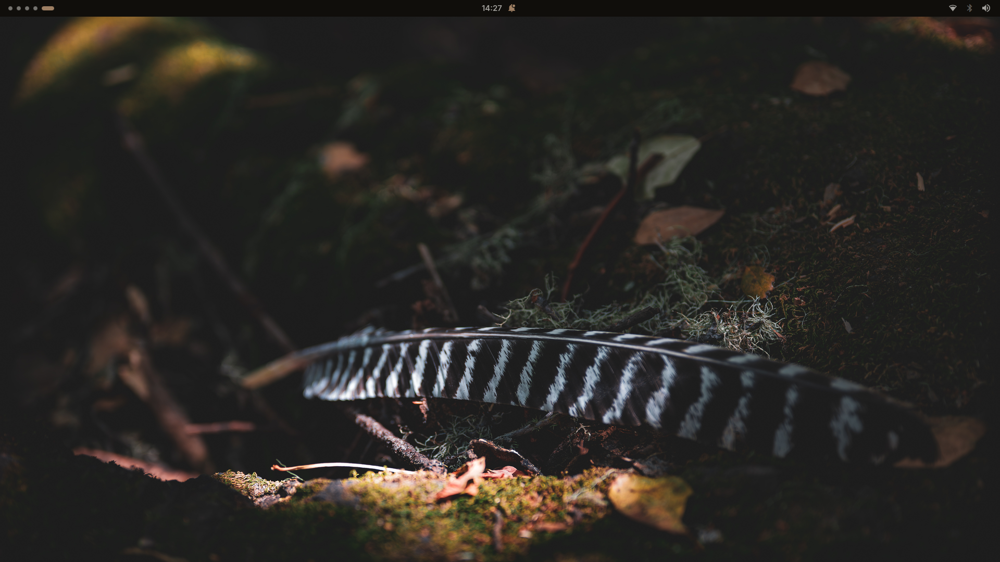
</p>

<p align="center">
  
</p>

<table>
  <tr>
    <td width="50%">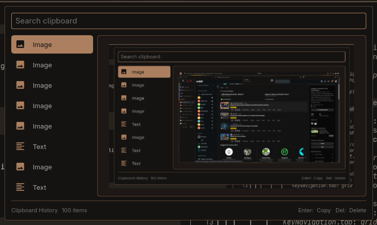<br><sub>Clipboard picker</sub></td>
    <td width="50%">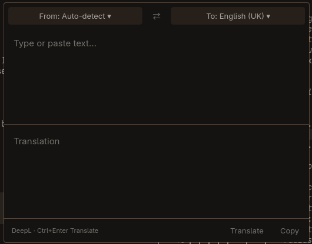<br><sub>Translator</sub></td>
  </tr>
  <tr>
    <td width="50%">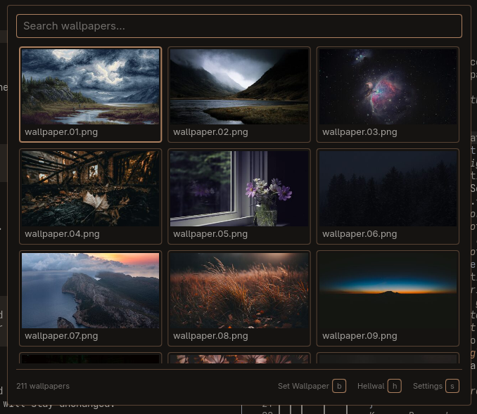<br><sub>Wallpaper picker</sub></td>
    <td width="50%">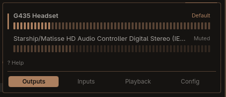<br><sub>Audio controls</sub></td>
  </tr>
  <tr>
    <td width="50%">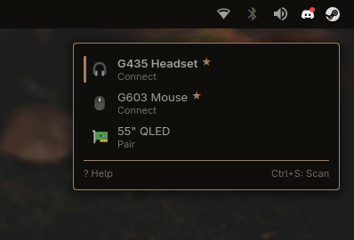<br><sub>Bluetooth menu</sub></td>
    <td width="50%">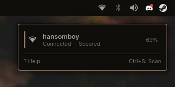<br><sub>Network menu</sub></td>
  </tr>
  <tr>
    <td width="50%">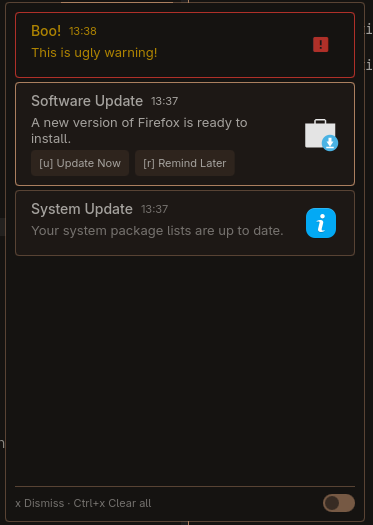<br><sub>Notification history</sub></td>
    <td width="50%">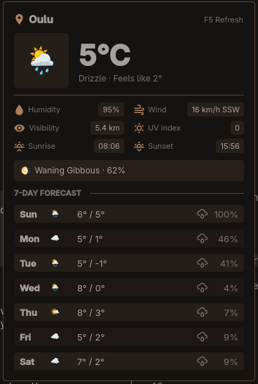<br><sub>Weather forecast</sub></td>
  </tr>
</table>

<p align="center">
  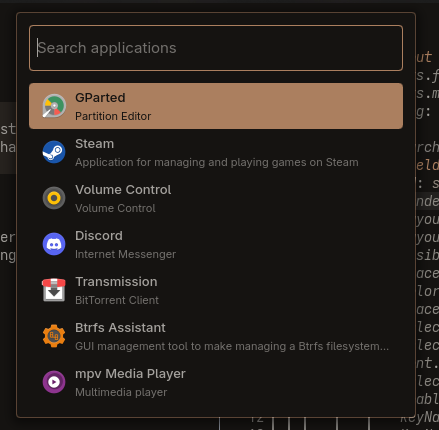<br>
  <sub>Application launcher</sub>
</p>

<p align="center">
  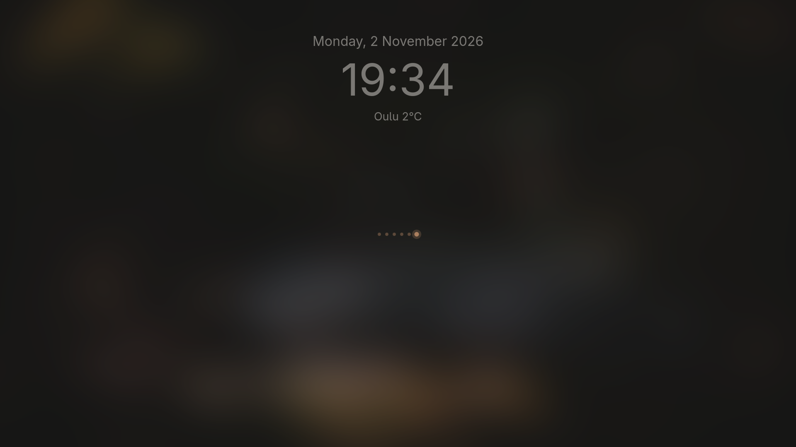<br>
  <sub>Lock screen</sub>
</p>

## Transparency

This shell was developed with LLM assistance under my supervision. I direct the design, review the changes, and test them on my own desktop. These are personal dotfiles, so review and adapt them before using them on yours.

This repository is mainly for hobby and learning, so don't expect everything to work out of the box.

## ISSUES 🔨

- ~~dmenu-runner can't display special symbols (Nerd fonts etc.)~~
- File structure is messy and files needs to be commented better
- There are probably plenty of other things as well. Maybe you can show me how to fix them or do better :)

## TODO

- [ ] Put there something
