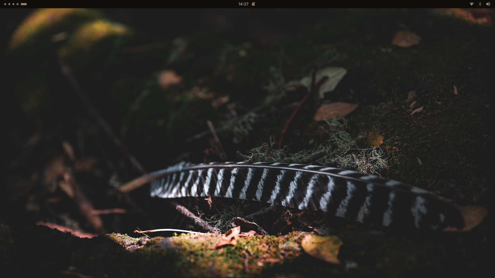
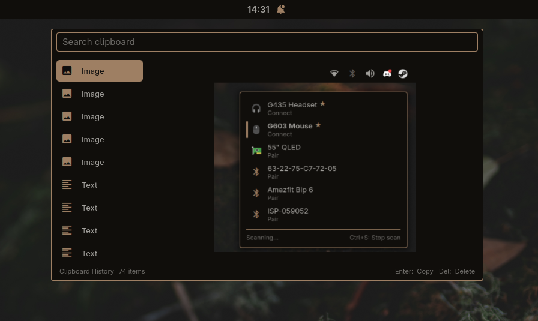
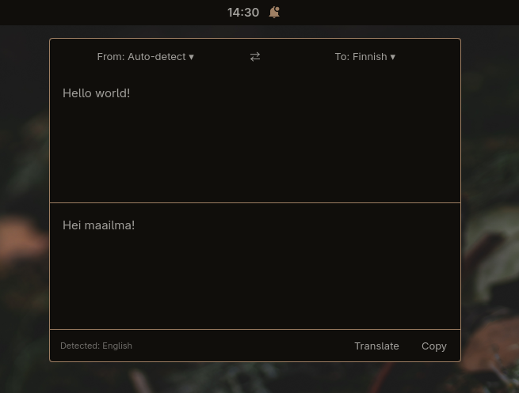
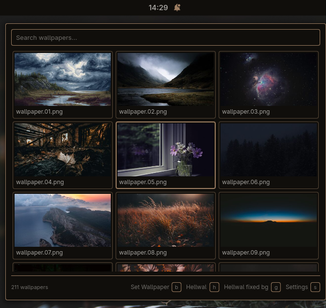
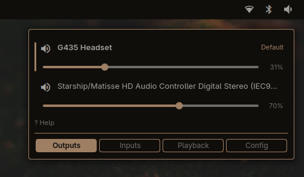
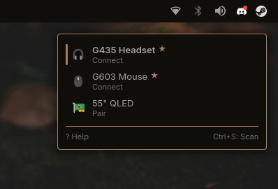
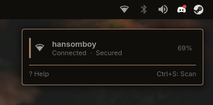
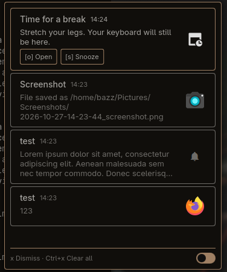

<p align="center">
  
</p>

<p align="center">
  A compact, keyboard-first desktop shell for <a href="https://github.com/YaLTeR/niri">Niri</a>, built with <a href="https://quickshell.org/">Quickshell</a>.
</p>

<p align="center">
  <a href="#features">Features</a> · <a href="#gallery">Gallery</a> · <a href="#launcher">Launcher</a> · <a href="#dmenu-mode">Dmenu mode</a> · <a href="assets/INSTALL.md">Installation</a>
</p>

## Slimshell

Slimshell brings my bar, notifications, and some useful menus together—replacing a collection of separate tools and increasingly complicated Bash scripts.

It is built for my own desktop: compact, opinionated, and comfortable to use from the keyboard. It isn't a desktop environment with endless customization or every bell and whistle. Borrow what you like, and adapt the rest.

## Why?

Why does this exist? Because all the well-known Quickshell setups focus too much on large Material Design Menus and features that, at the end of the day, no productive user actually needs. If a widget has functions, it must also work 100% with the keyboard. Bluetooth or the Wi-Fi menus do not need to take half of your 1440p screen space. So the goal was simple = Make the most of the best features of the Quickshell in terms of usability and lightness.

## Features

|              | What's included                                                                                 |
| ------------ | ----------------------------------------------------------------------------------------------- |
| **Bar**      | Workspaces, Window title, Clock, Battery, Connections, Tray etc.                                |
| **Menus**    | Keyboard-driven menus for Bluetooth, Wi-Fi, Audio, Power, and Notifications                     |
| **launcher** | Application launcher with: File Search, Calculator, Binary Runner, Emoji, Timers and Dmenu-mode |
| **Tools**    | Clipboard, DeepL translation, and Screen recording                                              |
| **Session**  | Lock Screen, Wallpaper Picker, and Dynamic theming with [Hellwal](https://hellwal.danihek.xyz/) |

<details>
<summary>IPC reference</summary>

| Target               | Calls                                                                  | Effect                                                   |
| -------------------- | ---------------------------------------------------------------------- | -------------------------------------------------------- |
| `audio`              | `toggle`, `open`, `close`                                              | Show or hide the audio popup                             |
| `bar`                | `toggle`, `hide`, `show`, `isVisible`                                  | Control or query bar visibility                          |
| `bluetooth`          | `toggle`, `open`, `close`                                              | Show or hide the Bluetooth popup                         |
| `clipboard`          | `toggle`, `open`, `close`, `refresh`, `copySelected`, `deleteSelected` | Control the clipboard picker                             |
| `idle`               | `toggle`, `isDisabled`, `settings`                                     | Control idle handling or open its settings               |
| `launcher`           | `toggle`, `open`, `close`                                              | Control the application launcher                         |
| `lock`               | `lock`                                                                 | Lock the session                                         |
| `locker`             | `isSecure`                                                             | Query whether the separate lock-screen process is secure |
| `menu`               | `packages`, `settings`, `system`, `close`                              | Open a main-menu page or close it                        |
| `network`            | `toggle`, `open`, `close`                                              | Show or hide the network popup                           |
| `notificationCenter` | `toggle`, `open`, `close`                                              | Show or hide notification history                        |
| `notifications`      | `toggleDnd`, `enableDnd`, `disableDnd`, `isDnd`, `clear`, `count`      | Control DND or notification history                      |
| `power`              | `toggle`, `open`, `close`                                              | Control the power menu                                   |
| `recorder`           | `toggle`, `open`, `close`, `fullscreen`, `region`, `stop`              | Control screen recording                                 |
| `theme`              | `refresh`, `usingHellwal`                                              | Reload or query the active theme                         |
| `translator`         | `toggle`, `open`, `close`                                              | Control the translator                                   |
| `volume`             | `up`, `down`, `mute`                                                   | Adjust or mute the default audio output; shows the OSD   |
| `wallpaper`          | `toggle`, `open`, `close`                                              | Control the wallpaper picker                             |

For example, `qs ipc call volume up` raises the volume by one step. `launcher/dmenu-runner` uses the launcher's IPC internally; call the script to open a picker.

</details>

## Launcher

Launcher modes. Switch directly with the shortcuts below, or cycle with **Ctrl+← / Ctrl+→**.

| Mode  | Shortcut | What it does                                             |
| ----- | -------- | -------------------------------------------------------- |
| Apps  | `Ctrl+A` | Search and launch desktop applications                   |
| Run   | `Ctrl+B` | Run binaries, with recently used commands first          |
| Emoji | `Ctrl+E` | Search by name and copy the selected emoji               |
| Timer | `Ctrl+T` | Start timers such as `25m Focus`, `45s`, `1:30`, or `2h` |

In Apps mode, `/<word>` searches files and `=expression` calculates with `qalc`. Plain math works too.

## Dmenu mode

For scripts that use dmenu-style pickers:

```bash
printf '%s\n' Search 'New Note' TODO Delete | ./launcher/dmenu-runner -p "Notes" -l 4 --minimal-lines
```

- Supported options: `-p` / `--prompt`, `-l N` / `--lines N` (default 7), `--minimal-lines`, and `--index` (return the original zero-based input index; typed text returns `-1`).
- Enter selects, Shift+Enter returns typed text, and Esc cancels with status 1. `-l 0` opens an input-only picker.

Slimshell must be running. This is a small dmenu-compatible runner, not a full dmenu/rofi replacement.

## Getting started

Follow the [installation guide](assets/INSTALL.md) for dependencies, Niri startup,
keybindings, and optional feature setup. Install into `~/.config/quickshell`, then run:

```bash
qs -p "$HOME/.config/quickshell" --no-detailed-logs
```

## Settings

Edit root-level `settings.json` for appearance and behavior defaults. Changes are
loaded automatically; invalid values use safe defaults, and malformed JSON keeps
the previous settings. Idle timeouts, wallpaper preferences and workspace layout
are adjusted through the UI and saved separately.

Audio styles are `classic` or `circle`; animation styles are `fade` or `slide`.
`animations.style` controls menus, while `notificationStyle` controls toasts.
Optional `animations.hostStyles` overrides individual menu styles (`audio`,
`network`, `bluetooth`, or `notificationCenter`).

## Tests

Run the offline tests with `python -B tests/run.py`, or select a feature, for example
`python -B tests/run.py launcher network`. Use `--list` to see the available features.
These tests do not start or reload the desktop shell.

## Structure

```text
shell.qml       Shell entrypoint and service wiring
settings.json   Editable appearance and behavior defaults
bar/            Bar and its modules
components/     Reusable UI and popup components
services/       Shared desktop state and integrations
launcher/       Launcher, dmenu runner, and search helpers
menus/          System and wallpaper menus
notifications/  Notification popups and history
clipboard/      Clipboard picker and previews
lock/           Lock screen components and PAM setup
recorder/       Screen recording and region selection
translator/     DeepL translator
wallpaper/      Wallpaper helpers
osd/            Volume overlay
```

## Gallery

<p align="center">
  
</p>

<table>
  <tr>
    <td width="50%"><br><sub>Clipboard picker</sub></td>
    <td width="50%"><br><sub>Translator</sub></td>
  </tr>
  <tr>
    <td width="50%"><br><sub>Wallpaper picker</sub></td>
    <td width="50%"><br><sub>Audio controls</sub></td>
  </tr>
  <tr>
    <td width="50%"><br><sub>Bluetooth menu</sub></td>
    <td width="50%"><br><sub>Network menu</sub></td>
  </tr>
  <tr>
    <td width="50%"><br><sub>Notification history</sub></td>
    <td width="50%"></td>
  </tr>
</table>

## Transparency

This shell was developed with LLM assistance under my supervision. I direct the design, review the changes, and test them on my own desktop. These are personal dotfiles, so review and adapt them before using them on yours.

This repository is mainly for hobby and learning, so don't expect everything to work out of the box.

## ISSUES 🔨

- ~~dmenu-runner can't display special symbols (Nerd fonts etc.)~~
- File structure is messy and files needs to be commented better
- There are probably plenty of other things as well. Maybe yoy can show me how to fix them or do better :)

## TODO

- [ ] Put there something
